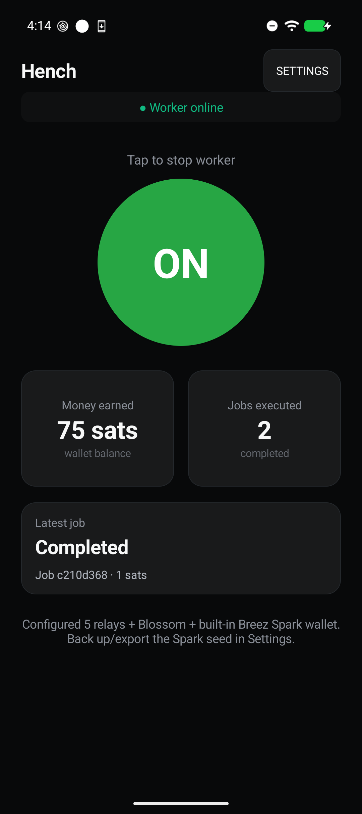
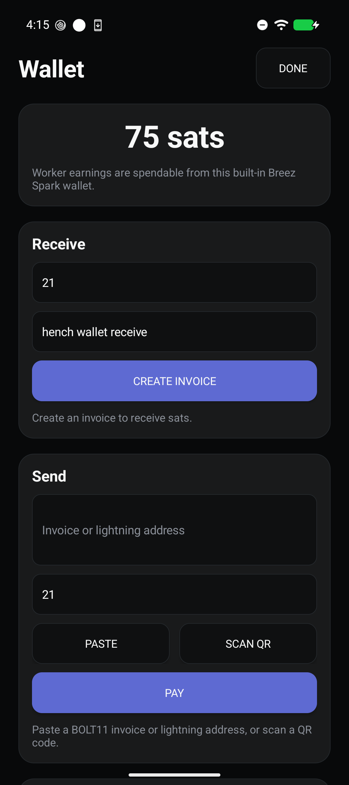
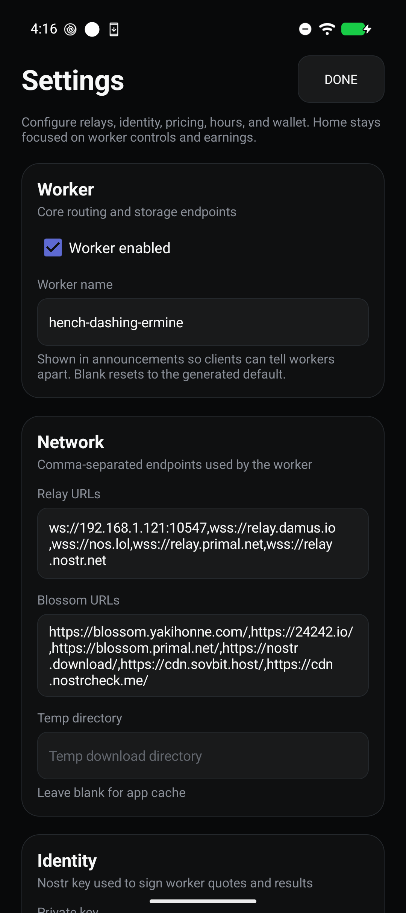

# Hench

**Turn your Android phone into a worker that earns sats.**

Hench is a ContextVM worker that lives on your phone, part of
[autonomica.xyz](https://autonomica.xyz). It offers tools as paid services
over Nostr — media downloads (powered by yt-dlp), real-browser page fetches,
and screenshots — plus user-installed Python script tools. A client requests
a tool call, pays a Lightning invoice, and Hench does the work: it fetches
the media, uploads the result to a Blossom server, and hands back a link.
The sats land in the wallet on your phone.

<p align="center">
  
  
  
</p>

## How it works

1. **Turn the worker on.** One big button. Hench announces itself on Nostr
   relays and starts listening for jobs.
2. **A client sends a job.** Someone (usually an AI agent) calls one of the
   advertised tools — `download_media`, `web_fetch`, `page_screenshot`, or an
   installed script tool. Hench quotes a price in sats.
3. **They pay, you earn.** Hench creates a Lightning invoice through its
   built-in [Breez Spark](https://spark.money) wallet. Payment settles,
   Hench runs the job, uploads the result to Blossom, and delivers the link.

Everything runs on the phone — no server to rent, no account to create.

## What you get

- **A worker, not a server.** Hench runs as a foreground service with a
  simple dashboard: worker on/off, sats earned, jobs executed, and live
  status of the latest job.
- **A real Lightning wallet.** Earnings settle to a built-in Breez Spark
  wallet you control. Send and receive sats right from the app, or export
  the recovery words to any Spark-compatible wallet. The Wallet screen can
  also mint an NWC (Nostr Wallet Connect) URI so other apps can spend from
  the wallet — keep that URI private. Prefer your own wallet for earnings?
  Connect over NWC in Settings instead.
- **yt-dlp under the hood.** The same engine that powers the web's best
  media downloader, bundled on-device and kept up to date.
- **Real-browser tools.** `web_fetch` and `page_screenshot` render pages in
  an offscreen WebView with a real Chromium fingerprint — bot-checked pages
  that datacenter fetchers can't reach. Renders run in an isolated,
  unauthenticated WebView profile, so a paying client never sees your logged-
  in sessions; private/internal hosts are refused outright.
- **Script tools.** Import a ZIP containing `manifest.json` and `script.py`
  through Settings to add a tool running on the bundled Python. Script tools
  have full app access — only enable packages you trust.
- **You set the prices.** Per-hour rates for audio and video, a base
  price per job, and working hours — all configurable in Settings.
- **Open coordination.** Jobs and results flow over Nostr; files are
  stored on Blossom servers. No middleman, no platform fee.

## Getting started

1. Install Hench on Android API 24+. Both arm64 and x86_64 native runtimes
   are bundled; curl TLS impersonation is arm64-only. Device verification
   currently covers arm64.
2. Open the app once. First launch automatically creates the Spark wallet,
   derives the worker identity, and turns the worker on.
3. Open **Settings → Wallet → Copy recovery words** to back up the 12
   words. Do this first; the words are the only way to restore your
   earnings (they recover the Nostr identity too).

## For developers

Source: <https://github.com/autonomica-xyz/hench>

Building requires JDK 17+ and Android SDK API 37 / build-tools 37.0.0. The build embeds a
Breez Spark API key from `breez.txt` at the repo root (gitignored; either a
bare key or `BREEZ_API_KEY=...`). Provision that file with your own Breez
key — never commit or print it:

```bash
./gradlew assembleRelease
```

Build the local native AARs before Gradle: follow `native-python/`,
`native-curl/`, `native-ffmpeg/`, `native-spark/`, and `native/`. Their pinned
inputs and patches replace vulnerable payloads embedded in the published
wrapper packages; a Maven version bump alone does not update those binaries.
The Python runtime documentation records the remaining upstream Expat risk.
Release shrinker rules must preserve JNA/UniFFI structure and callback names.
Verify the minified wallet too: debug builds do not exercise those rules.
NWC uses NIP-04's unescaped Base64 IV format; incoming wallet responses are
authenticated and correlated before decryption.

Unit tests: `./gradlew testDebugUnitTest`. Instrumented tests under
`src/androidTest` are written to run against an isolated QA applicationId
(`net.nostr.hench.qa`) — never against an install holding a real wallet.

## License

MIT for Hench's own code (see [LICENSE](LICENSE)). Bundled components retain
their licenses; the youtubedl-android wrappers and FFmpeg build impose GPL
distribution obligations. Before distributing an APK, provide the applicable
corresponding source and build inputs, not just the license text. Component
provenance is recorded in `native-*/` and `src/main/assets/third_party_notices.txt`.
